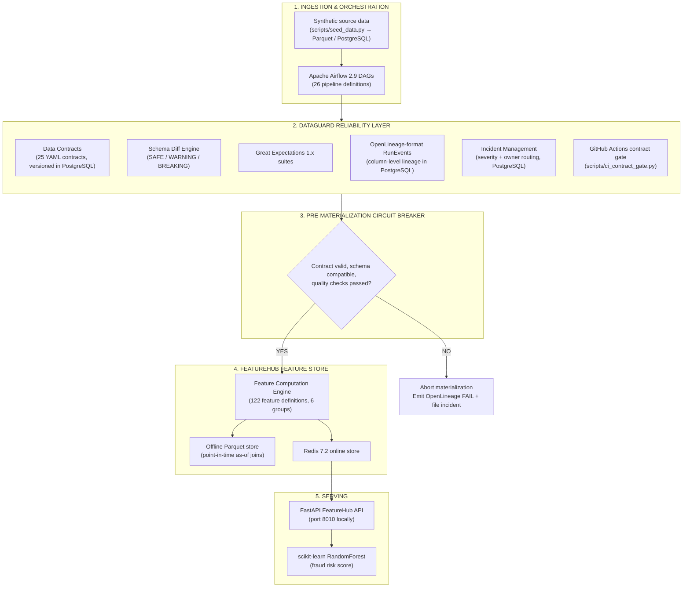
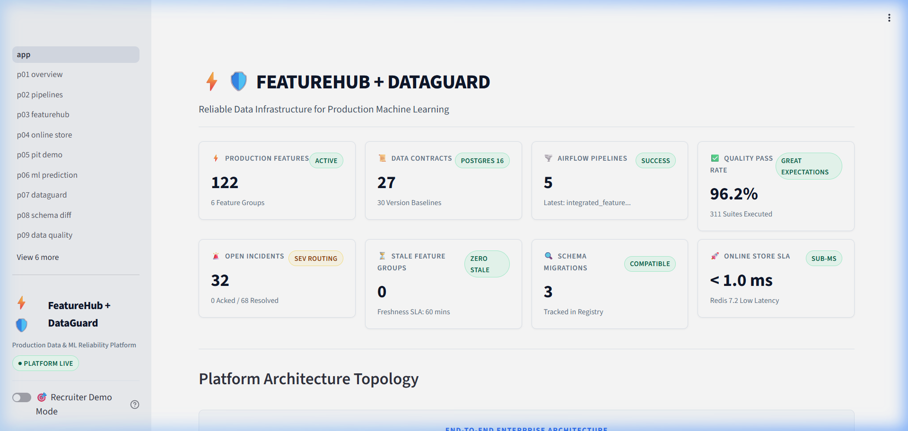
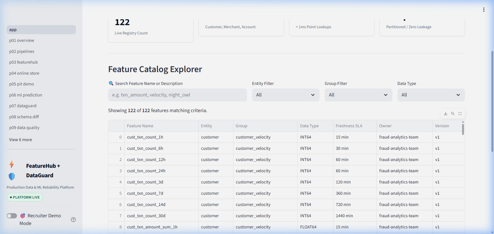
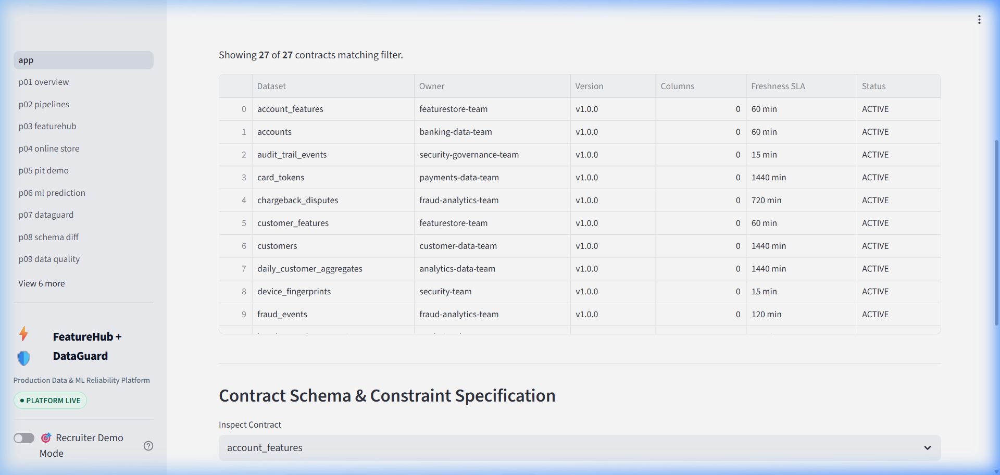
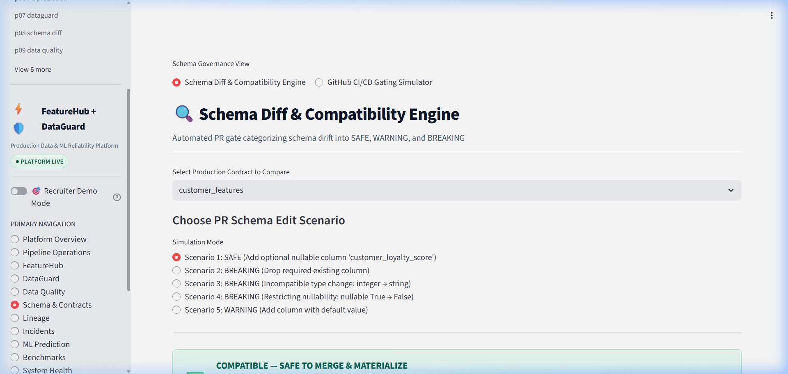
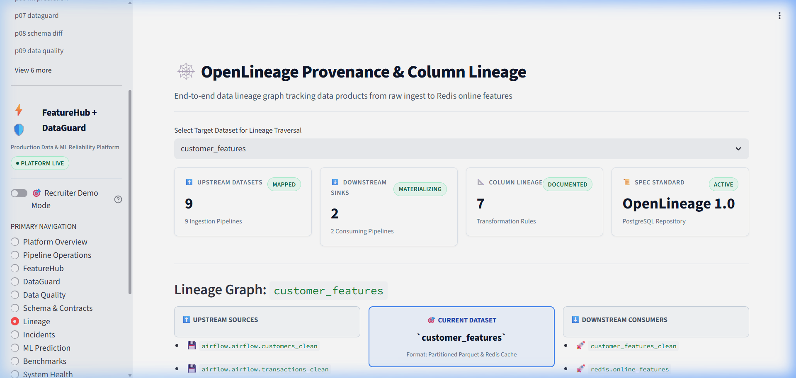
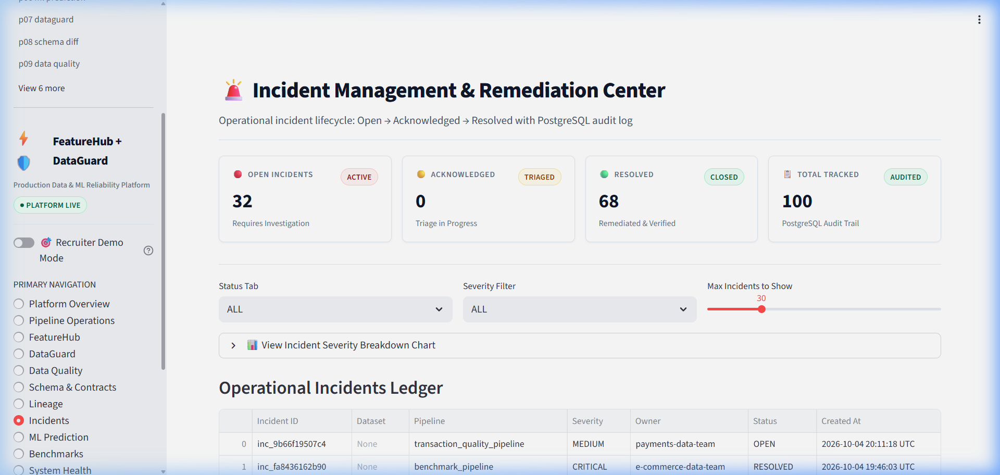
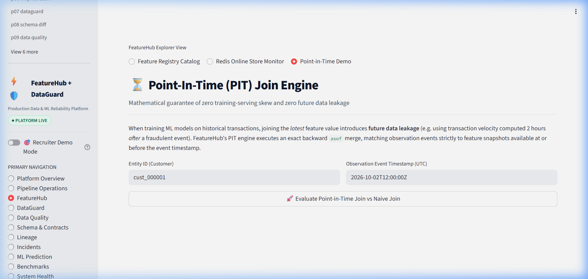
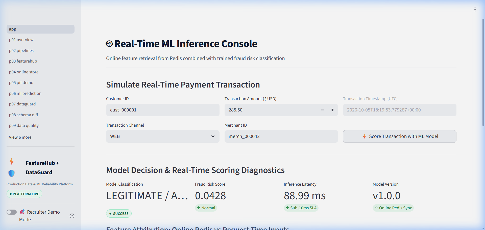

# FeatureHub + DataGuard

**A feature store with a data-reliability gate in front of it, built as a portfolio project for ML data infrastructure.**

[](LICENSE)

FeatureHub computes ML features into an offline Parquet store and materializes them to a Redis online store for low-latency serving, with point-in-time (as-of) joins for building training sets.
DataGuard sits in front of materialization: YAML data contracts, a schema diff engine that classifies changes as `SAFE` / `WARNING` / `BREAKING`, Great Expectations quality suites, OpenLineage-format run events with column-level lineage, and an incident store in PostgreSQL.
When a contract, schema or quality check fails, the integrated pipeline aborts before anything is written to Redis, emits an OpenLineage `FAIL` event and files an incident with an owner and severity.

> **Status: complete portfolio project, run locally on a single machine.** It is not deployed in production and has no real users.
>
> **All data is synthetic.** Customers, accounts, merchants and transactions are generated by [`scripts/seed_data.py`](scripts/seed_data.py) (fixed random seed, 5,000 customers / 6,500 accounts / 1,000 merchants / 100,000 transactions). Failure scenarios (breaking schema, null spikes, range violations, stale features) are injected deliberately. No real financial or customer data is used.

---

## Live demo

There is currently **no live demo**. An earlier public demo was exposed through temporary Cloudflare quick-tunnel URLs (`*.trycloudflare.com`) from the author's machine; those hostnames no longer resolve (checked 2026-10-29).
Note that the "public demo mode" gateway (`apps/public-api/`) serves a fixed snapshot of demo data from [`apps/public-api/demo_data.py`](apps/public-api/demo_data.py), not the live PostgreSQL/Redis stack. You can run it yourself with `python apps/public-api/run.py 8000`.

Other walkthroughs:
- **Recruiter walkthrough (3–5 min):** [`docs/demos/recruiter-demo.md`](docs/demos/recruiter-demo.md)
- **Video recording script:** [`docs/demos/demo-recording.md`](docs/demos/demo-recording.md)
- **Design decisions:** [`docs/DECISIONS.md`](docs/DECISIONS.md)

---

## Architecture



---

## The Project Story

### 1. FeatureHub: feature computation and serving
Feature transformations are defined once in code ([`featurehub/feature_definitions/definitions.py`](featurehub/feature_definitions/definitions.py), 122 definitions across 6 groups). The compute engine materializes sliding-window metrics (1h, 6h, 24h, 30d, …) into two stores:
- **Offline Parquet store:** used for historical point-in-time (as-of) joins. The join only picks feature rows with `feature_timestamp <= observation_timestamp`, which prevents future-data leakage into training sets; this is asserted in [`featurehub/tests/test_pit.py`](featurehub/tests/test_pit.py).
- **Online Redis store:** key-value lookups for live inference (see measured latency below).

### 2. DataGuard: contracts, schema diffing, quality and lineage
DataGuard treats internal datasets as products with explicit contracts:
- **Declarative data contracts:** 25 YAML contracts in [`dataguard/contracts/`](dataguard/contracts/), registered with version history in PostgreSQL 16.
- **Schema diff and compatibility engine:** compares contract versions or table migrations and classifies each change as `SAFE`, `WARNING` or `BREAKING` (type widening vs narrowing, nullability, enum and constraint changes).
- **Pre-merge CI gate:** [`.github/workflows/contracts.yml`](.github/workflows/contracts.yml) runs `scripts/ci_contract_gate.py` on pull requests that touch contracts and fails the check on `BREAKING` changes.
- **Great Expectations 1.x:** contract rules are compiled into expectation suites (not-null, unique, ranges, enums, freshness, referential checks).
- **Lineage and incidents:** OpenLineage-format `RunEvent`s (custom collector, stored in PostgreSQL rather than sent to Marquez) with column-level mappings; failures are deduplicated and filed as incidents with severity and owner.

### 3. Integration: circuit breaker in front of Redis
DataGuard runs as a gate inside the integrated pipeline ([`featurehub/integration/service.py`](featurehub/integration/service.py)):
```
Bad / drifted data (injected in the synthetic test scenarios)
       ↓
Contract, schema or quality check fails
       ↓
Incident filed in PostgreSQL (owner + severity)
       ↓
OpenLineage FAIL event recorded
       ↓
Feature materialization aborted
       ↓
Redis online store is not updated with the bad batch
```

---

## Measured results

**Environment for all numbers below:** one Windows 11 laptop (Intel, 16 logical cores, 15.7 GB RAM), Python 3.13.9, Redis 7.2 and PostgreSQL 16 in local Docker containers accessed over loopback, synthetic data, single client (concurrency 1), measured 2026-10-04. These are local single-machine figures, not production or cloud latencies.

| Metric | Result | Context | Source |
|---|---|---|---|
| Feature definitions | 122 features in 6 groups | Count of `FEATURE_CATALOG` entries | [`featurehub/feature_definitions/definitions.py`](featurehub/feature_definitions/definitions.py) |
| Pipeline definitions | 26 | Entries in the pipeline registry (definitions run against synthetic data, not production pipelines) | [`dataguard/pipelines/registry.py`](dataguard/pipelines/registry.py), [`docs/PIPELINE_INVENTORY.md`](docs/PIPELINE_INVENTORY.md) |
| Redis online lookup | p50 0.77 ms, p99 1.62 ms | 1,000 lookups after 100 warm-up, 100 customer keys, 65% hit rate | [`featurehub/benchmarks/final_results.json`](featurehub/benchmarks/final_results.json) (`redis_lookup_latency`) |
| `/predict` API (Redis features + scikit-learn) | p50 4.20 ms, p99 6.62 ms, 228.5 req/s | Sequential HTTP requests to `127.0.0.1:8010` | [`featurehub/benchmarks/final_results.json`](featurehub/benchmarks/final_results.json) (`http_prediction_api_latency`) |
| Point-in-time joins | No future-dated feature rows joined in test cases | 5 unit tests (future features, missing history, multiple entities) | [`featurehub/tests/test_pit.py`](featurehub/tests/test_pit.py) |
| Breaking schema changes blocked | 5 of 5 breaking scenarios blocked, 3 of 3 safe scenarios passed | Hand-written 8-scenario suite; the script prints results, no results file is committed | [`scripts/schema_breaking_experiment.py`](scripts/schema_breaking_experiment.py) |
| Great Expectations validation | 100,000 rows × 15 checks in 281 ms mean (≈355k rows/s; slowest of 3 runs 290 ms) | In-memory synthetic `orders` DataFrame, referential checks disabled | [`dataguard/benchmarks/final_quality_results.json`](dataguard/benchmarks/final_quality_results.json) |
| Lineage queries | Column-lineage query 6.29 ms mean; full graph / upstream / downstream queries 19–21 ms mean | 25 samples each, PostgreSQL-backed graph of 137 nodes | [`dataguard/benchmarks/final_lineage_results.json`](dataguard/benchmarks/final_lineage_results.json) |
| Circuit-breaker failure paths | 912 ms (breaking schema), 974–1,027 ms (stale / null / range violations) | One run per scenario, end-to-end time until abort + incident filed | [`featurehub/benchmarks/integration_results.json`](featurehub/benchmarks/integration_results.json) (`failure_paths`) |

More detail: [`docs/CV_METRICS.md`](docs/CV_METRICS.md), [`docs/FINAL_BENCHMARK_INDEX.md`](docs/FINAL_BENCHMARK_INDEX.md), [`docs/benchmarks/BENCHMARK_METHODOLOGY.md`](docs/benchmarks/BENCHMARK_METHODOLOGY.md).

**Not a result:** a reduction in incident-triage time (e.g. "55% lower MTTR") is a **design goal only and has not been measured**. The repository only measures how quickly incidents are created and queried; see [`docs/benchmarks/incident_triage_experiment.md`](docs/benchmarks/incident_triage_experiment.md).

---

## Technology Stack

- **Data engineering & storage:** PostgreSQL 16, Redis 7.2, Apache Airflow 2.9, Apache Parquet, PyArrow, Pandas, NumPy
- **Data quality & governance:** Great Expectations 1.x, OpenLineage event format (custom collector), YAML data contracts with Pydantic v2 models, schema compatibility engine
- **Backend & APIs:** Python 3.12 / 3.13, FastAPI, Uvicorn, SQLAlchemy
- **Observability:** Prometheus 2.50, Grafana
- **Machine learning:** scikit-learn (RandomForestClassifier), Joblib
- **Frontend:** Streamlit, Plotly
- **DevOps:** Docker, Docker Compose, GitHub Actions

`feast` and `openlineage-python` are listed in `requirements.txt` but are not imported by the code.

---

## Quickstart: local full platform

Requires Python 3.12+ and Docker.

```bash
# 1. Clone repository
git clone https://github.com/Charanloyal/featurehub-dataguard.git
cd featurehub-dataguard

# 2. Install Python dependencies
pip install -r requirements.txt

# 3. (Optional) environment file. Docker Compose reads POSTGRES_* and AIRFLOW__CORE__FERNET_KEY from .env;
#    the Python code reads POSTGRES_* / REDIS_* / DATABASE_URL from the shell environment and falls back
#    to the same local defaults as docker-compose.yml.
cp .env.example .env

# 4. Start local infrastructure (service names from docker-compose.yml)
docker compose up -d postgres redis airflow

# 5. Seed synthetic data & register contracts
python scripts/seed_data.py
python scripts/register_contracts.py

# 6. Start the APIs (separate terminals)
uvicorn featurehub.api.main:app --port 8010
uvicorn dataguard.api.main:app --port 8001

# 7. Check service health
python scripts/healthcheck.py

# 8. Execute the integrated pipeline
python scripts/run_integrated_pipeline.py

# 9. Launch the unified dashboard
streamlit run apps/unified-dashboard/app.py --server.port 8505
```

`docker compose up -d --build` (or `make start`) additionally builds containerized APIs (FeatureHub on port 8000, DataGuard on 8001), the two single-product Streamlit dashboards (8501, 8502), Prometheus and Grafana.

### Local services
- **Unified dashboard:** `http://localhost:8505`
- **Airflow (standalone mode):** `http://localhost:8080` — user `admin`; the generated password is printed in the `featurehub_dataguard_airflow` container logs
- **Prometheus:** `http://localhost:9090`
- **Grafana:** `http://localhost:3000` (default `admin` / `admin`, local only)
- **FeatureHub API docs:** `http://localhost:8010/docs`
- **DataGuard API docs:** `http://localhost:8001/docs`

---

## Platform Screenshots

Screenshots of the unified Streamlit dashboard running locally on synthetic data:

| Platform Overview | FeatureHub Catalog (122 Features) |
|:---:|:---:|
|  |  |

| DataGuard Contracts Registry | Schema Diff & Breaking Gate |
|:---:|:---:|
|  |  |

| OpenLineage Graph Traversal | Operational Incident Center |
|:---:|:---:|
|  |  |

| Point-in-Time Leakage Prevention | ML Fraud Inference |
|:---:|:---:|
|  |  |

---

## API Reference (selected endpoints)

### FeatureHub (`featurehub/api/main.py`)
- `GET /features`: catalog of registered features.
- `GET /features/{name}`: metadata and SLA for a feature.
- `GET /feature-groups`: feature groups.
- `GET /online/features/{entity_id}`: entity feature vector from Redis.
- `GET /offline/features`: offline (Parquet) feature retrieval.
- `POST /predict`: fraud probability from the scikit-learn model using online features.
- `POST /pipeline/integrated-run`: run the DataGuard-gated integrated pipeline.

### DataGuard (`dataguard/api/main.py`)
- `GET /contracts`, `GET /contracts/{name}/versions`: registered contracts and versions.
- `POST /schema/diff`: compare two contracts and return `SAFE`, `WARNING` or `BREAKING`.
- `POST /quality/validate/{dataset}`, `GET /quality/summary`: run / summarize Great Expectations validations.
- `GET /lineage/{dataset}` (+ `/upstream`, `/downstream`, `/columns`): dataset and column lineage.
- `GET /incidents`, `POST /incidents/{id}/ack`, `POST /incidents/{id}/resolve`: incident triage.
- `GET /pipelines`: the 26 pipeline definitions.
- `POST /ci/gate`, `POST /ci/gate/pr`: contract compatibility gate used by CI.

---

## Tests

```bash
# Full suite (the *_postgres tests and integration tests need PostgreSQL and Redis running)
pytest -v

# Tests that need no running services
pytest featurehub/tests/test_pit.py dataguard/tests/test_type_compatibility.py dataguard/tests/test_phase_a_contracts.py

# Schema breaking-change experiment
python scripts/schema_breaking_experiment.py

# Reset the deterministic demo baseline
python scripts/reset_demo.py
```

**Status:** the author's local run with PostgreSQL and Redis running is summarized in [`docs/FINAL_TEST_RESULTS.md`](docs/FINAL_TEST_RESULTS.md) (276 tests reported passing on 2026-10-04; a hand-written summary, not a raw pytest log).
On GitHub Actions the **"Platform CI & Quality Gates" (ruff step) and "Test Suite" (full pytest step) workflows currently fail on `main`**; only the Docker Compose validation workflow passes. The CI test job does not start PostgreSQL or Redis services.

---

## Security notes

- Credentials are read from environment variables. Local development defaults (`platform_admin` / `platform_secure_pass` for PostgreSQL, `admin` / `admin` for Grafana) are in `docker-compose.yml` and `dataguard/contracts/registry.py` and must not be reused outside a local machine.
- The Airflow Fernet key is read from `AIRFLOW__CORE__FERNET_KEY` (see `.env.example`). An earlier commit hard-coded a key in `docker-compose.yml`; treat that key as public.
- All service ports in `docker-compose.yml` are published on the host; this setup is meant for a local machine only.
- The public demo gateway (`apps/public-api/`) is read-only, serves static demo data, and adds `X-Content-Type-Options`, `X-Frame-Options` and `X-XSS-Protection` headers.

---

## Limitations

- **Synthetic data only.** All entities and transactions come from `scripts/seed_data.py`; failure scenarios are injected. Results say nothing about behaviour on real financial data.
- **Single-machine benchmarks.** Latency and throughput were measured once on one Windows laptop with Redis/PostgreSQL over loopback and a single client; no load or concurrency testing, no cloud deployment.
- **Incident-triage time reduction is unverified.** It is a design goal, not a measured outcome (no human study was run).
- **CI gate scope.** The 5/5 breaking-change result covers an 8-scenario hand-written suite, not real-world schema history.
- **CI currently failing** on `main` (lint and full test steps), see above.
- **Airflow on Windows.** DAG tests can run against a lightweight compatibility shim ([`pipelines/airflow/shim.py`](pipelines/airflow/shim.py)) when Apache Airflow is not installed; the real scheduler only runs in the Docker container.
- **No live demo** at the moment; the public gateway served a static snapshot.
- **Single-node, single-process compute.** Pandas/PyArrow on one machine; no Spark, no Redis cluster, no auth/RBAC.

More detail: [`docs/LIMITATIONS.md`](docs/LIMITATIONS.md).

---

## Related repositories

`Charanloyal/featurehub` and `Charanloyal/dataguard` are earlier split copies of this repository (snapshots of the Phase J state, 2026-10-04). This combined repository is the maintained version.

---

## Documentation Index

- [`docs/demos/recruiter-demo.md`](docs/demos/recruiter-demo.md) — 3–5 minute demo walkthrough
- [`docs/demos/demo-recording.md`](docs/demos/demo-recording.md) — video recording script
- [`docs/interview/technical-questions.md`](docs/interview/technical-questions.md) — technical deep-dive Q&A
- [`docs/CV_METRICS.md`](docs/CV_METRICS.md) — metric ledger with sources
- [`docs/CV_READY_PROJECT_ENTRIES.md`](docs/CV_READY_PROJECT_ENTRIES.md) — resume bullet drafts
- [`docs/DECISIONS.md`](docs/DECISIONS.md) — design choices and trade-offs
- [`docs/LIMITATIONS.md`](docs/LIMITATIONS.md) — limitations and disclosures
- [`docs/PIPELINE_INVENTORY.md`](docs/PIPELINE_INVENTORY.md) — the 26 pipeline definitions
- [`docs/FINAL_TEST_RESULTS.md`](docs/FINAL_TEST_RESULTS.md) — author's local test summary
- [`docs/deployment/live-demo.md`](docs/deployment/live-demo.md) — how the public demo gateway was run

---

## License

MIT License. See [LICENSE](LICENSE) for details.
